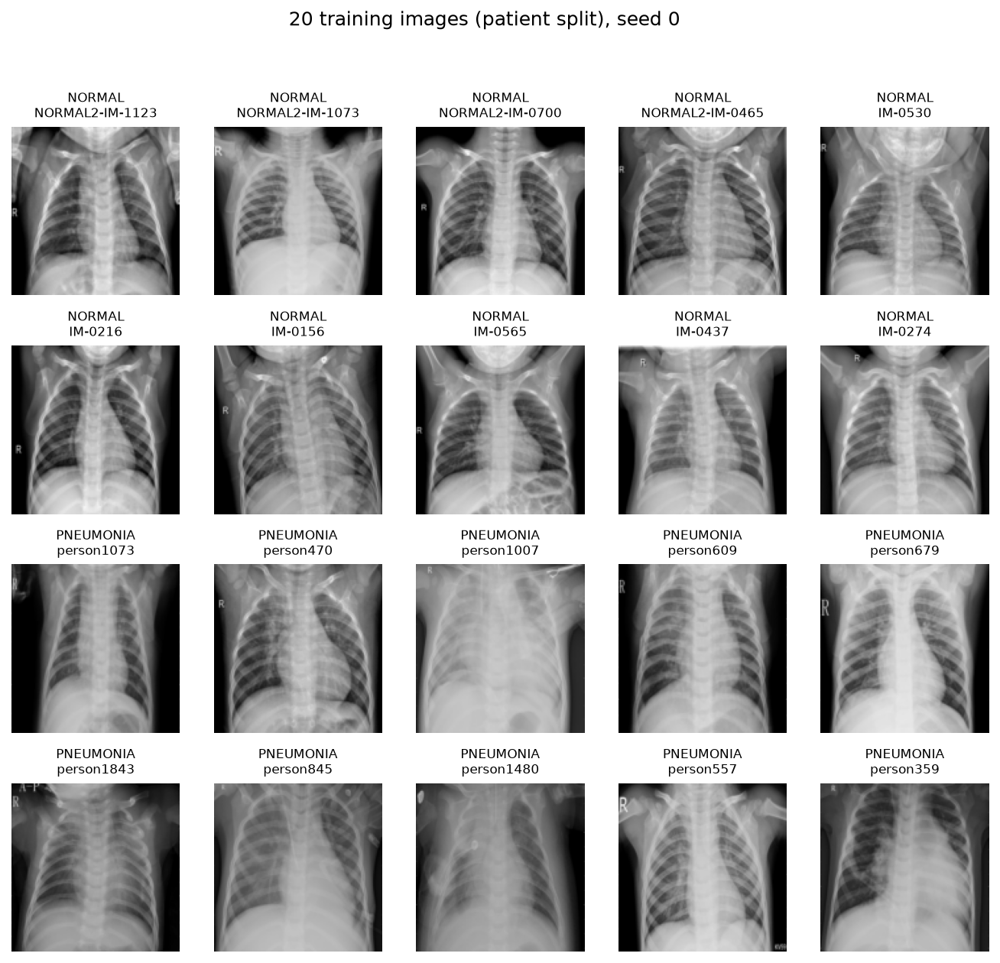

# Pediatric Pneumonia Detection in Chest X-rays

**Biomedical Image Analysis · M.Sc. Applied Data Science and AI · SRH University Munich · Winter semester 2026/27**
**Author(s):** Ashok Rai · **Repository:** https://github.com/ashok-rai/bia-pediatric-pneumonia-cxr · **Date:** 29.11.2026

---

## Abstract

I asked whether an ImageNet-pretrained CNN can tell pneumonia from normal in pediatric chest X-rays (Kermany et al., 2018), as a triage aid. After the first checkpoint I split the data **by child**: 457 training images of 170 children who also appear in the test set were dropped, and validation was split by child. The model and its threshold were chosen **on validation only**, then measured once on the 624 official test images. The final model, a fine-tuned ResNet-18 at threshold 0.996, found 380 of 390 pneumonias (97.4 %, 95 % CI 95.7–98.9 %) and 172 of 234 normals (73.5 %), with 86.0 % precision, 88.5 % accuracy and AUC 0.943 (CI 0.922–0.961), against a floor of 62.5 % (always "pneumonia"). The split by child lowered the frozen network from 85.6 % to 83.2 % accuracy (same recipe). Its probabilities are over-confident (calibration error 0.226). The model is a research result, not a triage tool.

## 1 · The biomedical problem (15 %, with section 2)

- **Clinical question:** Can a model flag pediatric chest X-rays that show pneumonia, so a doctor can prioritise (triage) them, especially where radiologists are scarce?
- **Task type:** Binary image classification. Input: one 2D chest X-ray. Output: pneumonia or normal.
- **Why it is hard:** Class imbalance (more pneumonia than normal images). Signs of pneumonia can be subtle and overlap with other findings. Images vary in quality and size. Several images can come from the same child.

## 2 · The data (15 %, with section 1)

| | |
|---|---|
| Source, version, download date | Kermany, Zhang, Goldbaum (2018), "Labeled Optical Coherence Tomography (OCT) and Chest X-Ray Images for Classification", Mendeley Data V2, doi:10.17632/rscbjbr9sj.2 (chest X-ray part, `ChestXRay2017.zip`). Paper: Kermany et al., Cell 172(5), 2018. Downloaded 19.11.2026 |
| Licence | CC BY 4.0 (checked on the data set page): use and sharing allowed with attribution |
| Modality | X-ray (chest radiograph, anterior-posterior), 2D |
| Size | 5,856 JPEG images (5,232 official train / 624 official test). Pixel size: not reported. Used at 128 × 128 (baselines, frozen CNN) and 224 × 224 (fine-tuned CNN) |
| Labels: who made them | Two expert physicians graded the images after a quality check removed unreadable scans; a third expert checked the evaluation set (Kermany et al., 2018). The label is the diagnosis from the X-ray, not confirmed by a lab test. Bacterial or viral is only given in the file names |
| Labels: agreement | Not reported as a number (two graders, plus a third check on the evaluation set) |
| Classes or targets | NORMAL / PNEUMONIA. Pneumonia share: training 71.5 %, validation 73.1 %, test 62.5 % |
| Splits | **By child** (`notebooks/01_patient_split_audit.ipynb`, `splits/patient_split.csv`): 4,043 / 732 / 624 images (training / validation / test) from 2,287 / 404 / 427 children. 15 % of the children per class go to validation (seed 0). Test = the official test folder, unchanged. **457 training images of 170 children who also appear in the test set were dropped** |
| Quality checks | Children shared before (template, split by image) → after (split by child): train∩test 161 → 0, train∩val 297 → 0, val∩test 32 → 0; near-twins val vs train 3 → 0, test vs train 0 → 0 (`results/own/01_overlap.md`). All 170 leaked children have `person*` pneumonia IDs; no normal child leaked |
| Where my data could differ | One hospital (Guangzhou Women and Children's Medical Center); device and protocol not reported; children aged 1–5 only; labels from physicians reading the X-ray |
| A possible shortcut | "R" markers, corner text and tubes are visible (`01_examples.png`); file names follow a different pattern per class. Tested by masking the image border (section 5) |
| Shared with Deep Learning? | No. My Deep Learning project is a different one (Project 6, Kim CNN) |

Data table as written by the notebook: `results/own/01_data_table.md`. Typical images: 

## 3 · Experimental design (15 %)

- **Split:** by child (section 2). Training is used for fitting, validation for every choice, test once at the end.
- **The floor:** Always say "pneumonia": 62.5 % test accuracy, 100 % sensitivity, 0 % specificity.
- **Classical baselines:** Random forest (300 trees, random_state 0) on a 48-value intensity histogram plus an 8 × 8 thumbnail ("RF-template"); a GLCM texture forest (6 properties × 3 distances); and both combined.
- **Deep-learning models:** ResNet-18 pretrained on ImageNet, all with a class-weighted loss.
  - (A) frozen body with a new linear layer at 128 px; Adam 1e-3, batch 64, 10 epochs; 3 seeds.
  - (B) fully fine-tuned at 224 px; Adam 1e-4, batch 32, up to 8 epochs, keeping the epoch with the best validation AUC; 1 seed.
  - (C) like B with light augmentation (no horizontal flip); 3 seeds.
- **How the final model was chosen (validation only):** The final configuration is the one with the highest **mean validation AUC**: B with 0.999 (A 0.994, C 0.871). The threshold is the highest value that keeps **validation** sensitivity ≥ 95 % (B: 0.996). Notebook 03 prints test numbers, but they play no role in the choice. Notebook 04 reloads the saved checkpoint and looks at the test set once. The old "plain vs. balanced" choice, which I made on test, no longer exists: every configuration uses the class-weighted loss.
- **Comparisons:** All models on the same 624 test images, plus a before/after comparison of the same recipes on the image split and on the split by child.

## 4 · Implementation and reproducibility (25 %)

- **Run it:** four notebooks, in order: `01_patient_split_audit` → `02_baselines` → `03_cnn_finetune` → `04_evaluation_shortcuts`. Each one downloads the data if missing and reads the files the previous one wrote. Versions are in `requirements.txt`: numpy 2.4.6, torch 2.14.1, torchvision 0.29.1, scikit-learn 1.6.1, scikit-image 0.26.0, plus matplotlib, Pillow, requests.
- **Seeds, hardware, training time:** Split seed 0; random forest random_state 0; frozen head seeds 0, 1, 2 (1 s per run); fine-tuned B seed 0 (153 s per run on a Google Colab Tesla T4). Notebooks 01, 02 and 04 ran locally (Apple MPS). MPS and CUDA are not bit-exact; when notebook 04 reloads the checkpoint, its probabilities differ from notebook 03's by at most 0.00005.
- **Where the results come from:** Every number and figure is a notebook output in `results/own/`. The checkpoint `data/models/03_final.pt` is too large for git; re-run notebook 03 to create it.
- **The "before" run:** the template notebook and its outputs are kept in git history at commit `de4a0e1`.

## 5 · Evaluation, validation and critical analysis (15 %)

**Before and after the split by child** (same recipe, threshold 0.5, 624 test images):

| Model | Before: split by image (leaky) | After: split by child |
|---|---|---|
| ResNet-18 frozen, class-weighted | 85.6 % acc · 381/390 · 153/234 | 83.2 % acc · 384/390 · 135/234 |
| Random forest (histogram + thumbnail) | 76.8 % acc · 385/390 · 94/234 · val AUC 0.998 | 78.0 % acc · 384/390 · 103/234 · val AUC 0.984 |

The network lost 2.4 points of accuracy and 18 normals. For the forest, the leak mainly inflated the validation score (0.998 → 0.984), not the test score. The 161 shared children from my first report counted only the template's training part; I dropped 170, every child of the official training folder (template training plus validation) who is also in test.

**Final comparison** (thresholds chosen on validation, test looked at once; `results/own/04_final_table.md`):

| Model | Threshold | Accuracy | Precision | Sensitivity = recall | Specificity | Test AUC |
|---|---|---|---|---|---|---|
| floor: always "pneumonia" | – | 62.5 % | 62.5 % | 390/390 (100 %) | 0/234 (0 %) | 0.500 |
| RF-template | 0.633 | 85.9 % | 83.3 % | 378/390 (96.9 %) | 158/234 (67.5 %) | 0.927 |
| ResNet-18 frozen (A, seed 0) | 0.700 | 85.7 % | 82.9 % | 379/390 (97.2 %) | 156/234 (66.7 %) | 0.954 (3 seeds ± 0.000) |
| **ResNet-18 fine-tuned (B) = final** | 0.996 | **88.5 %** (CI 85.9–90.9 %) | **86.0 %** | **380/390 (97.4 %)** (CI 95.7–98.9 %) | **172/234 (73.5 %)** (CI 67.7–79.0 %) | **0.943** (CI 0.922–0.961) |
| Kermany et al. 2018 (InceptionV3, paper) | – | 92.8 % | – | 93.2 % | 90.1 % | 0.968 |

CIs: 2,000 bootstrap test sets (`04_bootstrap.png`). The GLCM forest was weaker (AUC 0.846) and did not improve the template features (`02_baselines.md`).

- **Metrics that fit the task:** Sensitivity matters most, since missing pneumonia is the worst error. On its own it misleads (the floor reaches 100 %), so I report specificity and precision next to it, plus AUC, which does not depend on the threshold.
- **Worst cases (`04_worst.png`):** The 8 most confident mistakes are all normal children called pneumonia.
- **Calibration (`04_calibration.png`):** ECE 0.226. Temperature scaling fitted on validation (T = 1.49) only reaches 0.222. The model is over-confident.
- **Shortcut test (`04_masking.md`):** Masking the outer 15 % of the image lowers AUC from 0.943 to 0.924. The border **alone** still gives AUC 0.762, so the edges carry some label information, but most of the decision comes from the lung field.
- **What the forest uses (`02_perm_importance.png`):** Shuffling single features on test (permutation importance) shows the forest relies mostly on the 8 × 8 thumbnail (AUC-drop mass 0.027) rather than the histogram (0.002); the most important features are the brightest histogram bin and pixels in the bottom row of the thumbnail.
- **Ceiling:** Kermany et al. report higher specificity (90.1 %) with a larger model (InceptionV3); their split is the official one, which shares 170 children between train and test.
- **Limitations:**
  - Validation is easier than test (val AUC 0.999 vs. test 0.943), so the threshold chosen on validation may not carry over.
  - B has one seed only.
  - Config C was invalid: I applied ColorJitter after normalisation, which clipped the inputs, so C is excluded.
  - One hospital, children aged 1–5, internal test only.

## 6 · Explainability, ethics and clinical responsibility (5 %)

- **Sanity check (`04_sanity.png`):** With a random last layer, the Grad-CAM maps change: correlations between trained and random maps range from 0.12 to −0.48, far from 1. So the maps depend on what the model learned (check passed).
- **A map I would show (`04_gradcam.png`, 2nd column):** a found pneumonia, p = 1.00; the hot area lies over the central chest and the lungs.
- **A map I would not trust (`04_gradcam.png`, 4th column, and both false alarms):** the missed pneumonia lights up the left image edge, outside the body, and the two false alarms light up the abdomen below the lungs. Grad-CAM shows where the score reacts, not why; the masking test (border alone: AUC 0.762) confirms that the edges carry some signal.
- **Harm and responsibility:** A missed pneumonia can delay treatment for a child. With 73.5 % specificity, about 1 in 4 normal children would be flagged, which means extra work and worry. A doctor must still read every image. The data are pediatric and de-identified; I only use the public release.

## 7 · Use of AI tools (5 %)

I used ChatGPT for planning the workplan, explaining concepts (transfer learning, calibration, bootstrap) and debugging (Colab download, Grad-CAM hooks); GitHub Copilot for code completion and first drafts of README and report text; and Devin AI for auditing the repository against the checkpoint and preparing the submission. No result comes from an AI tool: all numbers are notebook outputs in `results/own/`, and I checked every suggestion by running it, reading the output, or comparing with the data source and the paper. Dated log: [AI_USAGE_LOG.md](AI_USAGE_LOG.md).

## 8 · Conclusion (documentation and communication, 5 %)

A fine-tuned ResNet-18, chosen on validation after splitting by child, finds 97.4 % of pneumonias and 73.5 % of normals on the untouched test set; the split by child cost the frozen network 2.4 points. This is promising, but not ready for triage. Next steps:

1. Train B with more seeds (only seed 0 so far).
2. Fix the augmentation order (augment, then normalise) and re-run C.
3. Test on an external data set from another hospital.
4. Improve calibration beyond temperature scaling.
5. Crop or segment the lungs before classification, to remove the border signal.

## References

1. Kermany, D. S., et al. (2018). Identifying Medical Diagnoses and Treatable Diseases by Image-Based Deep Learning. *Cell*, 172(5), 1122–1131. doi:10.1016/j.cell.2018.02.010. Pneumonia vs. normal: 92.8 % accuracy, 93.2 % sensitivity, 90.1 % specificity, AUC 96.8 %.
2. Kermany, D., Zhang, K., Goldbaum, M. (2018). Labeled Optical Coherence Tomography (OCT) and Chest X-Ray Images for Classification. Mendeley Data, V2. doi:10.17632/rscbjbr9sj.2. https://data.mendeley.com/datasets/rscbjbr9sj
